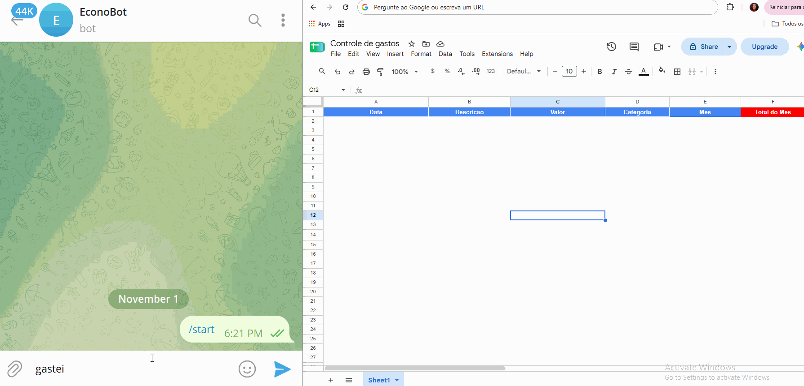
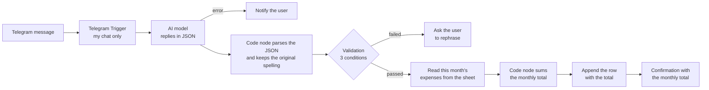

# Telegram Expense Bot

🇧🇷 **[Leia em português](./README.md)**

A Telegram bot that logs expenses from natural-language messages. You write "gastei 35 no almoço" ("I spent 35 on lunch"), the AI extracts the description, amount and category, the workflow writes a row to Google Sheets, and the bot confirms in the chat, including the **month's running total**.

Built with **n8n**, **Docker Compose** and a swappable AI model (tested with OpenAI and with **Ollama** running locally, at no API cost).

> **Demo:**
>
> 

> **Note:** the bot talks to the user in Brazilian Portuguese, so the example messages, categories and spreadsheet headers below are kept in Portuguese on purpose.

---

## The problem

Tracking expenses day to day usually fails because of friction: opening the spreadsheet, finding the next empty row, typing the date, amount and category, and then adding everything up to see how much has been spent. When it takes effort, people put it off and forget.

## The solution

Send a short message on Telegram, the way you would say it out loud. The workflow does the rest and replies with the month's total.

**Example conversation:**

| You write | The bot replies |
|---|---|
| `gastei 35 no almoço` | ✅ Salvei: Almoço \| R$ 35 \| Alimentação<br/>📊 Total do mês: R$ 35,00 |
| `uber 23,90` | ✅ Salvei: Uber \| R$ 23.9 \| Transporte<br/>📊 Total do mês: R$ 58,90 |
| `gastei 35` | Não entendi 🤔 Me mande assim: "gastei 35 no almoço" |
| `oi, tudo bem?` | Não entendi 🤔 Me mande assim: "gastei 35 no almoço" |

("Salvei" = "Saved". "Não entendi" = "I didn't understand". The last two messages are rejected because they are not valid expenses.)

### How it works



1. The **Telegram Trigger** receives the message, but only from an authorized chat. Messages from anyone else are ignored.
2. A **Basic LLM Chain** asks the model for a JSON object with `descricao` (description), `valor` (amount), `categoria` (one of six options) and `valido` (valid or not). If the model fails, the bot says so instead of staying silent.
3. A **Code** node parses the model's reply with safe error handling, and keeps the exact spelling the user typed in the description.
4. An **IF** node only lets a message through if all three conditions are true:
   - the original message contains a number;
   - the AI marked it as `valido: true`;
   - the extracted description is neither empty nor a generic word (such as "gasto").
5. The workflow reads the current month's expenses from **Google Sheets**, adds the new amount, and writes the row with the running total.
6. The bot confirms the expense and reports the month's total.

## Results

Informal measurement on October 31, 2026, using 6 fictional expenses (uber, supermarket, netflix, pharmacy, lunch and electricity bill), timed by me. For the manual method, the time runs from the start of typing until the row is complete in the spreadsheet (already open). For the bot, it runs from the start of typing the message until the "✅ Salvei" confirmation arrives.

| Method | Average | Range |
|---|---|---|
| Manual (spreadsheet) | 21.5 s | 18.9 to 23.6 s |
| Telegram bot | 12.3 s | 10.0 to 14.8 s |

The bot was faster in all 6 cases, saving about 9 seconds per entry (roughly 43% less time).

- **Extraction quality:** 6 out of 6 expenses recorded correctly.
- **Invalid messages rejected:** 4 out of 4 (`oi, tudo bem?`, `gastei muito hoje`, `gastei 35` and `comprei 3 coisas`).

### Issues found during testing and how I fixed them

- **"gastei 35" was saved as "Gasto / Outros".** It had an amount but no description. I fixed it with an extra example in the prompt and a rule in the IF node that rejects empty or generic descriptions, regardless of what the AI replies.
- **Accents corrupted by the model.** "mecanico" came back as "Mecãnico". The workflow now looks for the description inside the original message and keeps the spelling the user typed, instead of trusting the model's text.
- **Structured Output Parser was unstable with a local model.** It rejected replies that were actually correct. I replaced it with a Code node that reads the JSON, strips markdown fences and, if anything is malformed, returns "invalid" instead of crashing the workflow.
- **Monthly total equal to the expense amount.** The code read the column `valor`, but the sheet header was `Valor`. n8n is case-sensitive, so the sum came out as zero. The code now accepts both spellings.

**Limitations of the measurement:** small sample, one person. The timing was taken **before** the monthly-total feature, which adds one extra read from the spreadsheet, so the current time may be slightly higher. In the manual test the spreadsheet was already open, so the real-world gain may be larger, but that was not measured. The first message after a period of inactivity is slower, because the local model has to be loaded into memory.

## Design decisions

- **The AI suggests, rules confirm.** Small models sometimes invent an expense when the message has none, or accept a message with no description. So the workflow does not rely on the AI's answer alone: it also checks by rule that there is a number and that the description is useful.
- **Fidelity to what the user typed.** The bot does not "fix" the description: if the original spelling cannot be preserved, it is better to keep the data faithful than to store an error invented by the model.
- **JSON parsing in code.** More predictable than the structured-output parser with local models, and with a safe fallback.
- **Running total per row.** Each row stores the month's total at the moment it was logged, like the balance on a bank statement. This keeps a history, but editing or deleting an old row leaves the totals of later rows outdated.
- **Swappable model.** The model node can be replaced (OpenAI, Gemini, Ollama...) without changing the rest of the workflow.
- **Bot restricted to one chat.** Every message uses processing power (or API credits), so the trigger only accepts the configured chat ID.
- **Secrets kept out of the repository.** Tokens and the domain live in `.env`, which is listed in `.gitignore`. The exported workflow uses placeholders instead of real IDs.

## Tech stack

n8n · Docker and Docker Compose · Telegram Bot API · Google Sheets API · ngrok · Ollama (`qwen2.5:7b` model) or OpenAI · JavaScript (Code nodes)

## Getting started

### Prerequisites

- Docker Desktop
- An [ngrok](https://ngrok.com) account (free plan, with one static domain)
- A Telegram bot created through `@BotFather` (keep the token)
- A Google account, for Google Sheets
- To run the AI locally: [Ollama](https://ollama.com) installed

### Step by step

1. **Clone the repository**

   ```bash
   git clone https://github.com/ludimilladev/telegram-expense-bot.git
   cd telegram-expense-bot
   ```

2. **Create the `.env` file** from the template and fill in your own values (no quotes, and the domain without `https://`):

   ```bash
   cp .env.example .env
   ```

3. **Start n8n and the tunnel**

   ```bash
   docker compose up -d
   ```

   Open `http://localhost:5678` and create the local n8n account.

4. **Download the model** (if you are using Ollama):

   ```bash
   ollama pull qwen2.5:7b
   ```

5. **Create the spreadsheet** in Google Sheets with these headers in row 1, spelled exactly like this: `Data`, `Descricao`, `Valor`, `Categoria`, `Mes`, `Total do Mes`. Format the `Mes` column as **Plain text** (Format, Number, Plain text), so Google Sheets does not turn `2026-11` into a date.

6. **Import the workflow:** in n8n, workflow menu → *Import from File* → `workflows/bot-gastos.json`.

7. **Create the credentials** in n8n:
   - **Telegram:** the token from BotFather.
   - **Google Sheets OAuth2:** follow the n8n documentation.
   - **Ollama:** Base URL `http://host.docker.internal:11434` (API key left blank).

8. **Replace the placeholders** in the imported workflow:
   - `SEU_CHAT_ID` ("YOUR_CHAT_ID"): in *Telegram Trigger → Additional Fields → Restrict to Chat IDs*. To find yours, check the `message.chat.id` output or use the `@userinfobot` bot.
   - `ID_DA_PLANILHA` ("SPREADSHEET_ID"): select your spreadsheet in the Google Sheets nodes (both the read and the write).

9. **Activate the workflow** (the *Active* toggle) and send a message to your bot.

> To test changes, deactivate the workflow before using *Execute workflow*. Telegram allows only one trigger per bot at a time.

## Limitations

- The bot only replies while the computer is on, Docker is running, the tunnel is up and, if you use Ollama, Ollama is open.
- Small local models make more mistakes than large cloud models, including when choosing the category. The validation rules reduce the problem but do not eliminate it.
- The bot preserves the spelling as typed and does not correct accents. Doing that reliably would require a larger model.
- The monthly total only sums rows that have the `Mes` column filled in; expenses added by hand without it are not counted.
- If an old row is edited or deleted, the running totals of the following rows are not recalculated.
- The free ngrok plan and the limits of free APIs may change.

## Next steps

- [x] Error handling with a message to the user when the model fails
- [x] Monthly total in the confirmation message
- [ ] A command to query the total (for example `total` or `total lazer`)
- [ ] Scheduled weekly summary, with a total per category
- [ ] Hosting on a server so the bot is always online

## Security and data

All examples use fictional expenses. Do not send real data to free AI APIs, whose terms may allow requests to be used to improve their products.