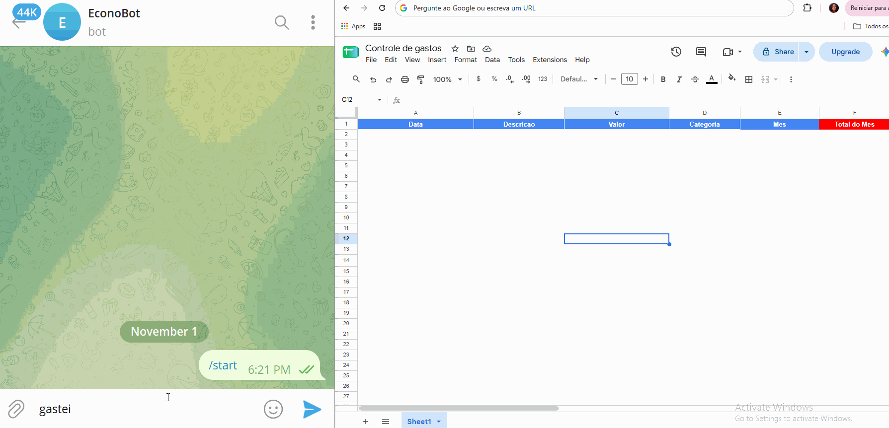
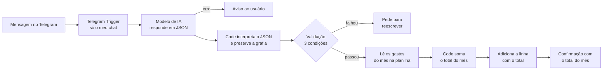

# Telegram Expense Bot

Bot do Telegram que registra gastos a partir de frases em linguagem natural. Você escreve "gastei 35 no almoço", a IA extrai descrição, valor e categoria, o fluxo grava uma linha no Google Sheets e o bot confirma no chat, já mostrando o **total gasto no mês**.

Construído com **n8n**, **Docker Compose** e um modelo de IA que pode ser trocado (testado com OpenAI e com **Ollama** rodando localmente, sem custo de API).

> **Demo:** `[PREENCHER: adicionar docs/demo.gif]`
>
> 

---

## O problema

Anotar gastos no dia a dia costuma falhar por atrito: abrir a planilha, achar a linha certa, digitar data, valor e categoria, e ainda somar para saber quanto já foi gasto. Quando dá trabalho, a pessoa deixa para depois e esquece.

## A solução

Mandar uma mensagem curta no Telegram, do jeito que a pessoa fala. O fluxo faz o resto e responde com o total do mês.

**Exemplo de conversa:**

| Você escreve | O bot responde |
|---|---|
| `gastei 35 no almoço` | ✅ Salvei: Almoço \| R$ 35 \| Alimentação<br/>📊 Total do mês: R$ 35,00 |
| `uber 23,90` | ✅ Salvei: Uber \| R$ 23.9 \| Transporte<br/>📊 Total do mês: R$ 58,90 |
| `gastei 35` | Não entendi 🤔 Me mande assim: "gastei 35 no almoço" |
| `oi, tudo bem?` | Não entendi 🤔 Me mande assim: "gastei 35 no almoço" |

### Como funciona



1. O **Telegram Trigger** recebe a mensagem, mas só de um chat autorizado. Mensagens de outras pessoas são ignoradas.
2. Um **Basic LLM Chain** pede ao modelo um JSON com `descricao`, `valor`, `categoria` (uma entre seis opções) e `valido`. Se o modelo falhar, o bot avisa em vez de ficar mudo.
3. Um nó **Code** interpreta a resposta do modelo, com tratamento seguro de erro, e preserva a grafia que a pessoa digitou na descrição.
4. Um nó **IF** só deixa passar se as três condições forem verdadeiras:
   - a mensagem original contém um número;
   - a IA marcou `valido: true`;
   - a descrição extraída não está vazia nem é uma palavra genérica (como "gasto").
5. O fluxo lê no **Google Sheets** os gastos do mês atual, soma com o gasto novo e grava a linha com o total acumulado.
6. O bot confirma o gasto e informa o total do mês.

## Resultado

Medição informal em 31/10/2026, com 6 gastos fictícios (uber, mercado, netflix, farmácia, almoço e conta de luz), cronometrados por mim. No método manual, o tempo vai do início da digitação até a linha completa na planilha (já aberta). No bot, vai do início da digitação da mensagem até a confirmação "✅ Salvei".

| Método | Média | Faixa |
|---|---|---|
| Manual (planilha) | 21,5 s | 18,9 a 23,6 s |
| Bot no Telegram | 12,3 s | 10,0 a 14,8 s |

O bot foi mais rápido nos 6 casos, com cerca de 9 segundos a menos por registro (aproximadamente 43% menos tempo).

- **Qualidade da extração:** `[6 de 6 gastos gravados corretamente]`.
- **Mensagens inválidas recusadas:** `[4 de 4]` (`oi, tudo bem?`, `gastei muito hoje`, `gastei 35` e `comprei 3 coisas`).

### Falhas encontradas nos testes e como foram corrigidas

- **"gastei 35" foi salvo como "Gasto / Outros".** Tinha valor, mas nenhuma descrição. Corrigi com um exemplo no prompt e com uma regra no IF que rejeita descrições vazias ou genéricas, independentemente da resposta da IA.
- **Acentos corrompidos pelo modelo.** "mecanico" virou "Mecãnico". O fluxo agora procura a descrição dentro da mensagem original e preserva a grafia digitada, sem confiar no texto gerado.
- **Structured Output Parser instável com modelo local.** Ele rejeitava respostas corretas do modelo. Troquei por um nó Code que lê o JSON, remove cercas de markdown e, se algo vier malformado, devolve "inválido" em vez de quebrar o fluxo.
- **Total do mês igual ao valor do gasto.** O código lia a coluna `valor`, mas a planilha tinha `Valor`. O n8n diferencia maiúsculas de minúsculas, então a soma dava zero. O código passou a aceitar as duas grafias.

**Limitações da medição:** amostra pequena e uma única pessoa. A medição de tempo foi feita **antes** da feature de total mensal, que acrescenta uma leitura da planilha ao fluxo, então o tempo atual pode ser um pouco maior. No teste manual, a planilha já estava aberta, então o ganho no uso real pode ser maior, mas isso não foi medido. A primeira mensagem depois de um tempo parado é mais lenta, porque o modelo local precisa ser carregado na memória.

## Decisões de projeto

- **A IA sugere, regras confirmam.** Modelos pequenos às vezes inventam um gasto quando a mensagem não tem nenhum, ou aceitam uma mensagem sem descrição. Por isso o fluxo não depende só da resposta da IA: ele também checa por regra se há número e se a descrição é útil.
- **Fidelidade ao que a pessoa digitou.** O bot não "corrige" a descrição: se a grafia original não puder ser preservada, é melhor manter o dado fiel do que gravar um erro inventado pelo modelo.
- **Interpretação do JSON por código.** Mais previsível que o parser de saída estruturada com modelos locais, e com fallback seguro.
- **Total acumulado por linha.** Cada linha guarda o total do mês no momento em que foi registrada, como o saldo de um extrato. Isso mantém um histórico, mas editar ou apagar uma linha antiga deixa os totais das linhas seguintes desatualizados.
- **Modelo trocável.** O nó do modelo pode ser substituído (OpenAI, Gemini, Ollama...) sem alterar o resto do fluxo.
- **Bot restrito a um chat.** Cada mensagem consome processamento (ou créditos de API), então o gatilho aceita apenas o chat ID configurado.
- **Segredos fora do repositório.** Tokens e domínio ficam no `.env`, que está no `.gitignore`. O workflow exportado usa marcadores no lugar de IDs reais.

## Tecnologias

n8n · Docker e Docker Compose · Telegram Bot API · Google Sheets API · ngrok · Ollama (modelo `qwen2.5:7b`) ou OpenAI · JavaScript (nós Code)

## Como rodar

### Pré-requisitos

- Docker Desktop
- Conta no [ngrok](https://ngrok.com) (plano gratuito, com um domínio estático)
- Um bot criado no Telegram pelo `@BotFather` (guarde o token)
- Conta Google, para o Google Sheets
- Para rodar a IA localmente: [Ollama](https://ollama.com) instalado

### Passo a passo

1. **Clone o repositório**

   ```bash
   git clone https://github.com/ludimilladev/telegram-expense-bot.git
   cd telegram-expense-bot
   ```

2. **Crie o `.env`** a partir do modelo e preencha com seus valores (sem aspas, e o domínio sem `https://`):

   ```bash
   cp .env.example .env
   ```

3. **Suba o n8n e o túnel**

   ```bash
   docker compose up -d
   ```

   Acesse `http://localhost:5678` e crie a conta local do n8n.

4. **Baixe o modelo** (se for usar o Ollama):

   ```bash
   ollama pull qwen2.5:7b
   ```

5. **Crie a planilha** no Google Sheets com estes títulos na linha 1, com esta grafia: `Data`, `Descricao`, `Valor`, `Categoria`, `Mes`, `Total do Mes`. Formate a coluna `Mes` como **Texto simples** (Formatar, Número, Texto simples), para o Google Sheets não converter `2026-11` em data.

6. **Importe o workflow:** no n8n, menu do workflow → *Import from File* → `workflows/bot-gastos.json`.

7. **Crie as credenciais** no n8n:
   - **Telegram:** token do BotFather.
   - **Google Sheets OAuth2:** siga o passo a passo da documentação do n8n.
   - **Ollama:** Base URL `http://host.docker.internal:11434` (API key em branco).

8. **Troque os marcadores** do workflow importado:
   - `SEU_CHAT_ID`: em *Telegram Trigger → Additional Fields → Restrict to Chat IDs*. Para descobrir o seu, veja a saída de `message.chat.id` ou use o bot `@userinfobot`.
   - `ID_DA_PLANILHA`: selecione a sua planilha nos nós do Google Sheets (leitura e gravação).

9. **Ative o workflow** (chave *Active*) e mande uma mensagem para o bot.

> Para testar mudanças, desative o workflow antes de usar *Execute workflow*. O Telegram permite um único gatilho por bot ao mesmo tempo.

## Limitações

- O bot só responde com o computador ligado, o Docker rodando, o túnel ativo e, se usar o Ollama, o Ollama aberto.
- Modelos locais pequenos erram mais que modelos grandes de nuvem, inclusive na escolha da categoria. As regras de validação reduzem o problema, mas não o eliminam.
- O bot preserva a grafia digitada e não corrige acentos. Corrigi-los de forma confiável exigiria um modelo maior.
- O total do mês só soma linhas que tenham a coluna `Mes` preenchida; gastos lançados à mão sem ela não entram na conta.
- Se uma linha antiga for editada ou apagada, o total acumulado das linhas seguintes não é recalculado.
- O plano gratuito do ngrok e os limites de APIs gratuitas podem mudar.

## Próximos passos

- [x] Tratamento de erro com mensagem ao usuário quando o modelo falhar
- [x] Total de gastos do mês na confirmação
- [ ] Comando para consultar o total (por exemplo, `total` ou `total lazer`)
- [ ] Resumo semanal agendado, com total por categoria
- [ ] Hospedagem em um servidor para o bot ficar sempre no ar

## Segurança e dados

Todos os exemplos usam gastos fictícios. Não envie dados reais a APIs de IA gratuitas, cujos termos podem permitir o uso das requisições para melhorar produtos.